# velpTEC Lernplattform · Weiterbildung KI-Management

Interaktive Lernplattform für die geförderte Weiterbildung **KI-Management** bei velpTEC:
aufgebaut nach dem **offiziellen velpTEC-Theorieskript „KI-Management“ (K7.0069)**: 8 Kapitel mit Praxisbezug, 4 Plus-Module, Quiz, Animationen, ein Pixel-Erklärfilm aus Code, Rangliste, Übungen mit Feedback
und die Möglichkeit, aus eigenen Übungsdokumenten neue Lektionen zu erzeugen.

- **Läuft komplett im Browser:** Es gibt weder Server noch Datenbank oder Build-Schritt.
- **Funktioniert vollständig ohne KI.** Die KI-Unterstützung ist optional. Lernende aktivieren sie selbst in den Einstellungen mit eigenem API-Key, entweder für Claude (Standard: `claude-haiku-5-5`), OpenAI, Gemini oder ein lokales Modell.

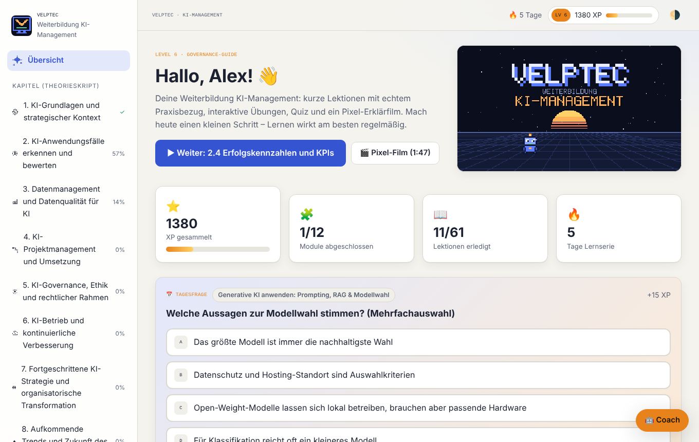

---

## Inhalt

1. [Was die Plattform kann](#was-die-plattform-kann)
2. [Screenshots](#screenshots)
3. [So nutzt du die Plattform (Lernende)](#so-nutzt-du-die-plattform-lernende)
4. [Für Lehrkräfte und Dozierende](#für-lehrkräfte-und-dozierende)
5. [Was gebaut wurde und wie](#was-gebaut-wurde-und-wie)
6. [Starten, Hosten, Entwickeln](#starten-hosten-entwickeln)
7. [Datenschutz](#datenschutz)
8. [Grenzen und offene Punkte](#grenzen-und-offene-punkte)

---

## Was die Plattform kann

| Bereich | Umfang |
|---|---|
| **Kursinhalte** | 8 Skriptkapitel + 4 Plus-Module, 61 Lektionen, 162 Quizfragen + 117 Quick-Checks, 24 Übungsaufgaben, 142 Quellen |
| **Theorieskript** | Die Plattform folgt dem velpTEC-Skript *„KI-Management – Theorieskript“* (K7.0069_4.0, 185 Seiten): **jedes Kapitel ist ein Modul, jeder der 37 Abschnitte hat mindestens eine Lektion.** Jede Lektion fasst die Kernaussagen des Abschnitts zusammen und nennt die Skriptseite. Die Seite „Theorieskript & Unterlagen“ zeigt das Inhaltsverzeichnis mit Links zu allen Lektionen. Das Skript selbst ist velpTEC-Kursmaterial und liegt **nicht** im Repository; die Plattform verlinkt nur das Original (Zugang für Berechtigte). |
| **Aktualisierungen** | 32 markierte Hinweise „Aktualisierung zum Skript“ mit Belegen, wo sich etwas geändert hat oder das Skript ungenau ist. Beispiele: Fristen des EU AI Act nach dem Digital Omnibus (VO (EU) 2026/1744); DSGVO-Bußgelder (20 Mio. € / 4 % sind die Obergrenze, kein Durchschnitt); falsch zugeordnete Studienzahlen; die Gartner-„85 %“ als Prognose von 2018. Studienzahlen ohne Fundstelle stehen als „laut Skript“ im Text. |
| **Plus-Module** | Vier Module gehen über das Skript hinaus: **Generative KI anwenden** (Prompting, RAG, Modellwahl), **Automatisierung & KI-Agenten mit n8n** (inkl. MCP, Make/Zapier/Power Automate), **KI-Werkzeugkasten** (Hugging Face, Ollama, LM Studio, europäische Anbieter, Vibe Coding) und **Fallstudien & Best Practices** (Fälle aus dem Skript plus reale, belegte Fälle). |
| **Praxisbezug** | Jede Lektion hat mindestens einen Praxisfall. Das sind entweder fiktive, als solche gekennzeichnete Mittelstandsbeispiele oder reale, belegte Fälle (z. B. Klarna, Air Canada, DPD, Otto Group). |
| **Interaktiv** | 14 Widgets: AI-Act-Klassifizierer, n8n-Workflow-Baukasten mit Challenges, Agenten-Schleife, RAG-Pipeline, Prompt-Builder, Konfusionsmatrix, ROI-Rechner, Token- und Energie-Rechner, Use-Case-Matrix, Risiko-Matrix, ADKAR-Check, Datenqualitäts-Spiel, neuronales Netz und Vorgehensmodell. Dazu Lernkarten, animierte Schrittfolgen und Zeitstrahlen. |
| **Quiz** | 6 Fragetypen: Single Choice, Multiple Choice, Richtig/Falsch, Reihenfolge, Zuordnung und Lückentext. Jede Antwort wird erklärt. Dazu kommen Quick-Checks mitten in den Lektionen und eine Tagesfrage. |
| **Motivation** | XP, 11 Level, 16 Badges und eine Lernserie. Im Wissens-Sprint beantwortet man 90 Sekunden lang Fragen und kann Combos sammeln. Hinzu kommen eine Rangliste und gelegentlicher Konfetti-Regen. |
| **Videos** | Der **Pixel-Motion-Graphic-Film** (1:47) ist komplett aus Code erzeugt, inklusive Chiptune-Soundtrack. Dazu kommen 16 geprüfte YouTube-Videos, die erst nach Klick laden (youtube-nocookie). |
| **Übungen** | Jede Übung hat ein Szenario, eine Aufgabe und ein Bewertungsraster. Es gibt gestufte Tipps, einen Offline-Check und optional KI-Feedback mit Nachfrage-Dialog. Die Musterlösung wird erst nach der Abgabe freigeschaltet. |
| **Eigene Lektionen** | Hochgeladene Übungsdokumente (PDF, DOCX, PPTX, XLSX, ODT, TXT, MD, HTML) werden zu einer neuen Lektion – offline oder mit KI. |
| **Lerncoach „Pixel“** | Mit KI arbeitet der Coach als hinführender Tutor, der Leitfragen statt Lösungen gibt. Ohne KI durchsucht er das gesamte Kursmaterial. |
| **Design** | Hell, dunkel oder automatisch. Ein ruhiges Indigo hilft bei der Konzentration, ein warmes Amber motiviert. Die Plattform ist responsiv, per Tastatur bedienbar und respektiert „Bewegung reduzieren“. |

---

## Screenshots

| | |
|---|---|
| 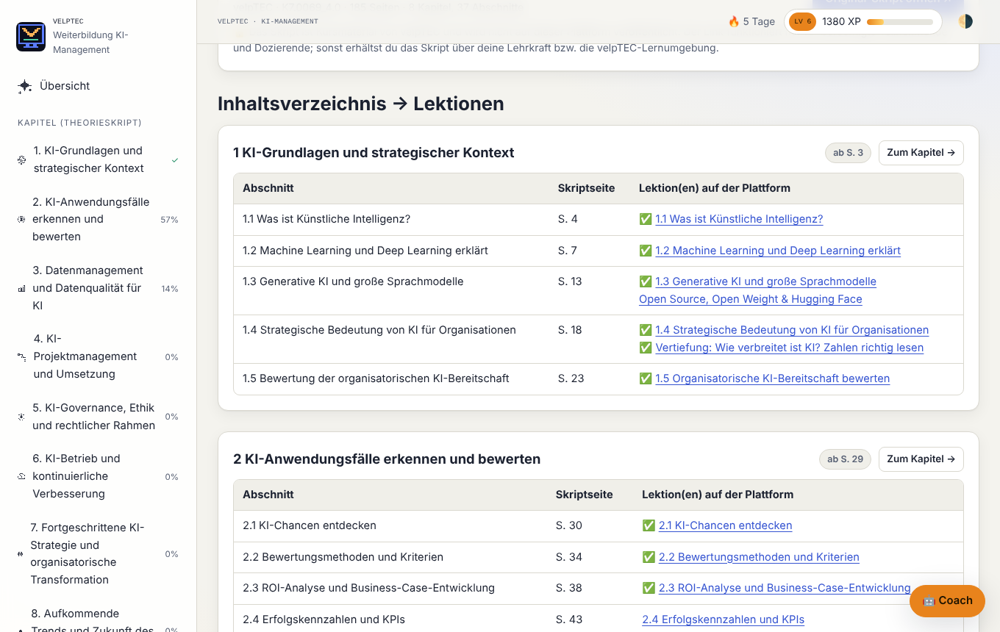 **Theorieskript.** Inhaltsverzeichnis des Skripts mit Seitenzahlen – jeder Abschnitt verlinkt auf seine Lektion(en), erledigte sind abgehakt. | 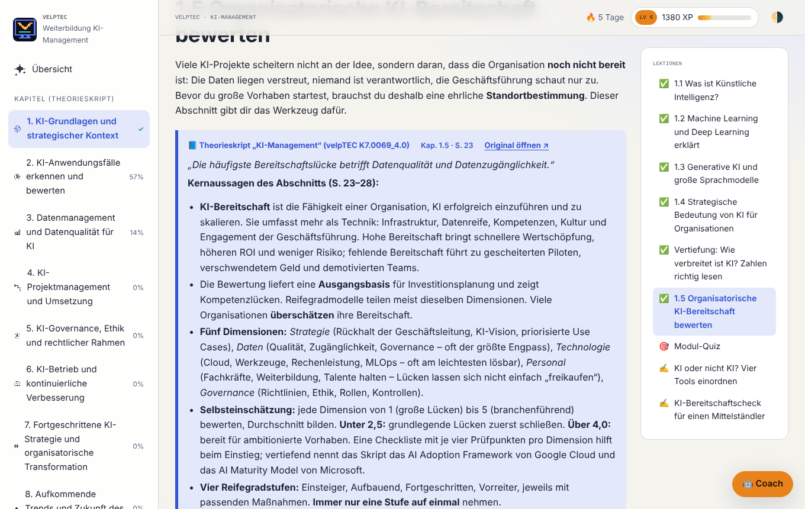 **Skriptbezug.** Jede Lektion fasst den Skriptabschnitt zusammen (Kapitel, Seite) und baut darauf auf. |
| 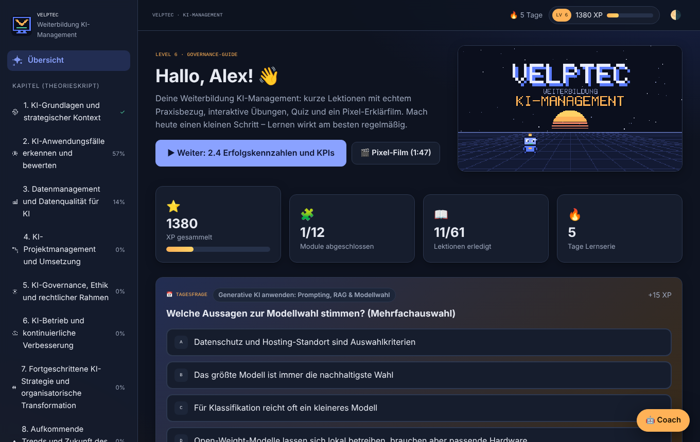 **Dunkelmodus.** Dashboard mit Level, Lernserie, Tagesfrage und Modulen. | 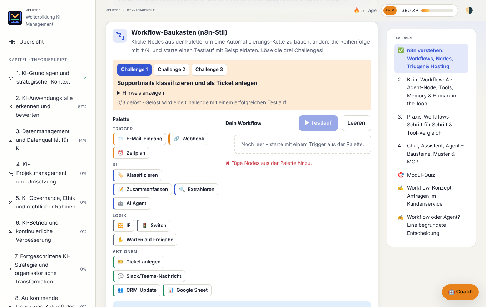 **Interaktiv.** n8n-Workflow-Baukasten mit Challenges und animiertem Testlauf. |
| 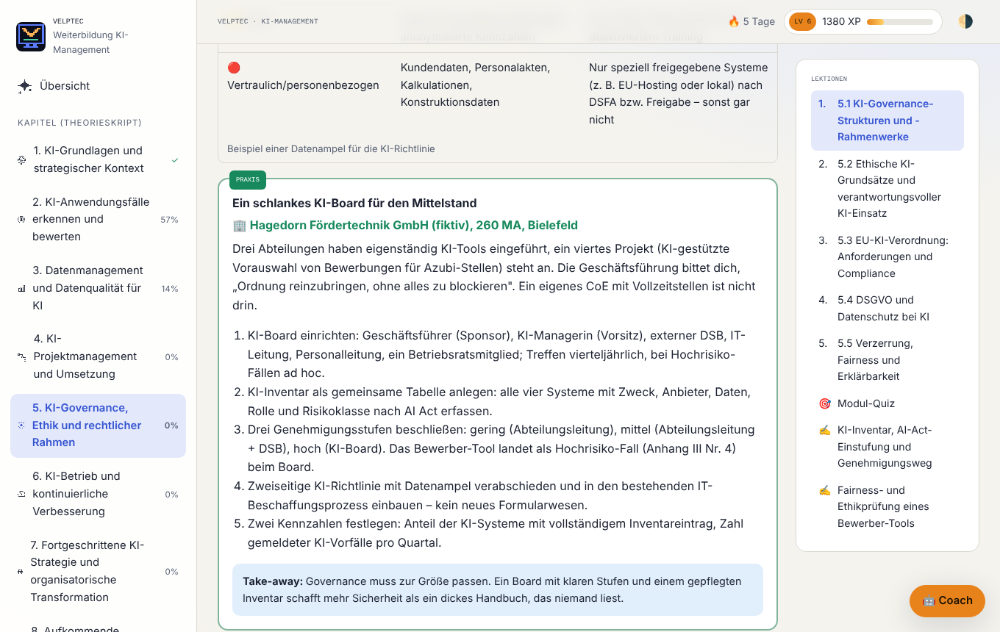 **Praxisbezug.** Jede Lektion enthält einen konkreten Praxisfall mit Schritten und Take-away. | 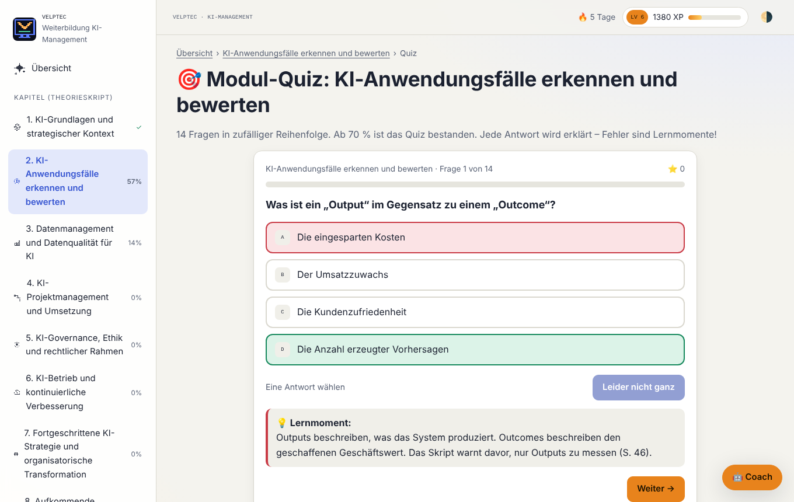 **Quiz.** Sofortige Erklärung, auch bei falschen Antworten. |
| 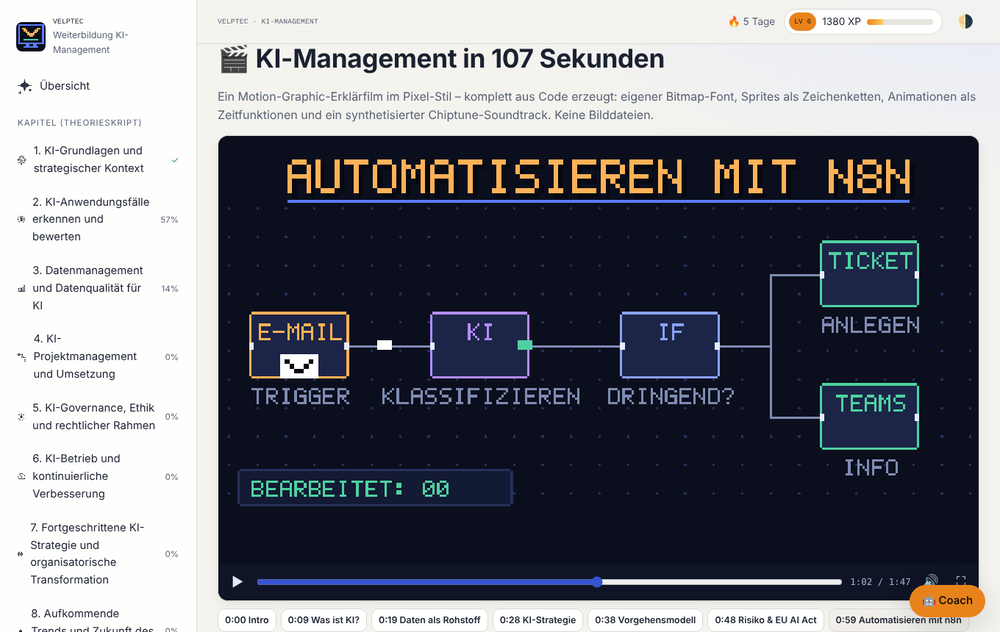 **Pixel-Film.** Komplett aus Code, mit Kapiteln, als MP4 oder direkt im Browser aufnehmbar. | 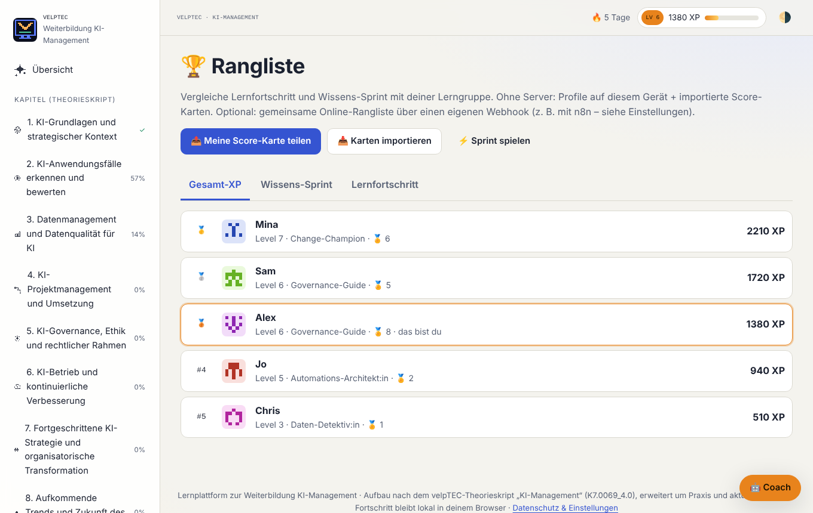 **Rangliste.** Gesamt-XP, Wissens-Sprint und Lernfortschritt. |
| 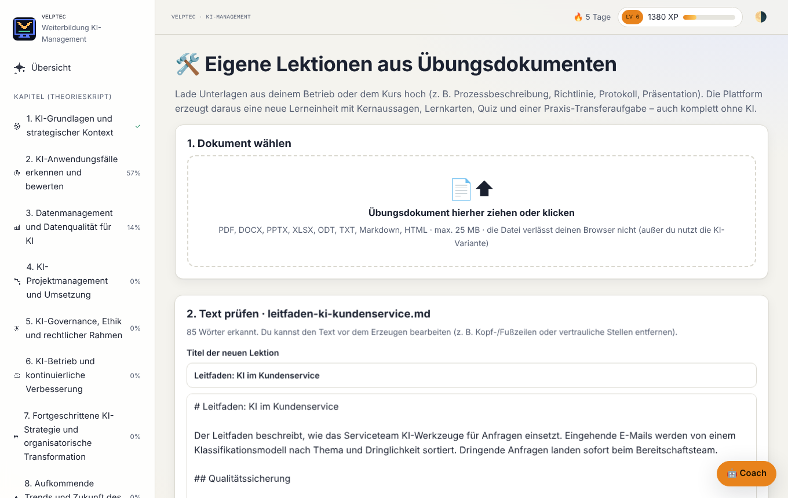 **Eigene Lektionen.** Dokument hochladen, Text prüfen und Lektion erzeugen. | 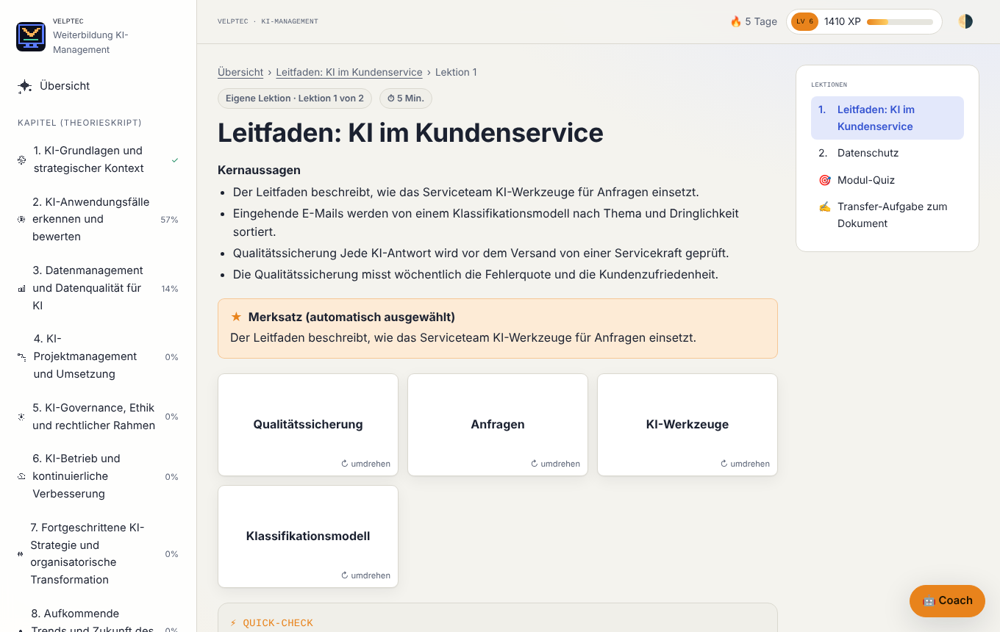 **Ergebnis:** Kernaussagen, Merksatz, Lernkarten, Quick-Check, Praxis-Transfer und Quiz. |
| 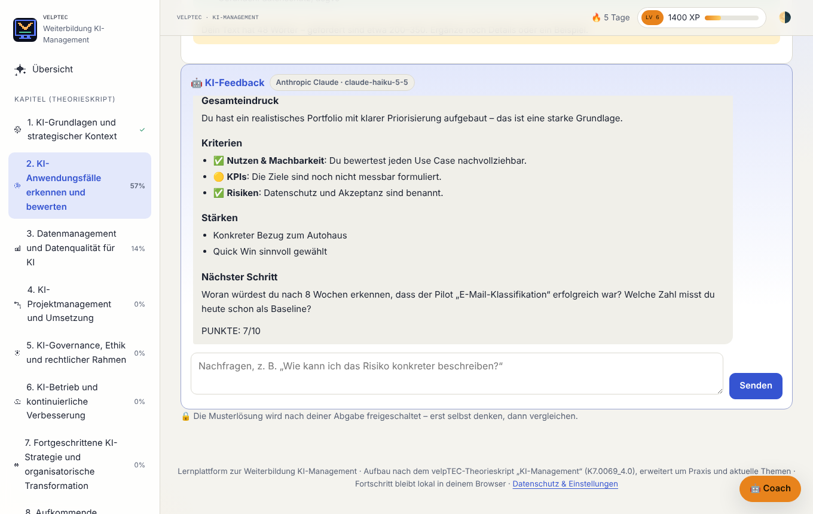 **Optionales KI-Feedback.** Bewertung je Kriterium und eine Leitfrage statt der fertigen Lösung. | 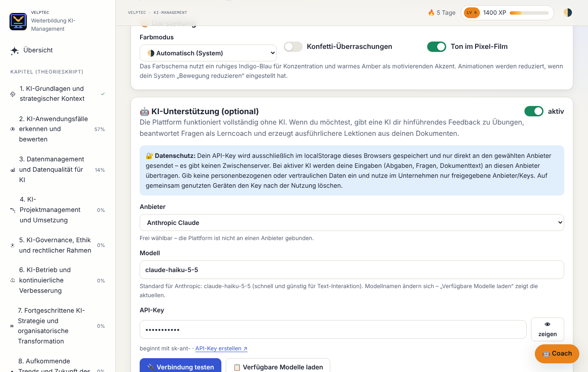 **KI-Einstellungen.** Anbieter frei wählbar, API-Key nur im localStorage. |

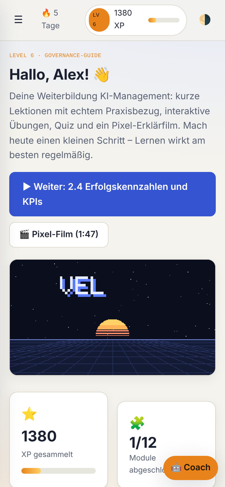

*Mobilansicht*

> Die Screenshots erzeugt `node tools/screenshots.mjs` automatisch mit einem Beispiel-Lernstand. Das KI-Feedback auf dem Bild ist eine simulierte Antwort; mit echtem API-Key antwortet das gewählte Modell.

---

## So nutzt du die Plattform (Lernende)

1. **Öffnen und Namen eingeben.** Ein Spitzname reicht. Er erscheint nur in der Rangliste.
2. **Mit Kapitel 1 starten** oder über „Weiter“ dort einsteigen, wo du aufgehört hast. Jede Lektion schließt du mit **„✓ Erledigt“** ab (+20 XP).
3. **Lektionen durcharbeiten:**
   - Text, Merksätze und Lernkarten (zum Umdrehen anklicken)
   - **Praxis-Kästen** (grün) mit Bezug zum Arbeitsalltag
   - **Skript-Kästen** (blau) fassen den Abschnitt des Theorieskripts zusammen und nennen Kapitel und Seite.
   - **Aktualisierungen** (gelb gestrichelt) zeigen an, wo sich seit dem Skript etwas geändert hat oder es ungenau ist.
   - **Interaktive Elemente** und **Quick-Checks** helfen dir zu prüfen, ob du es verstanden hast.
4. **Quiz am Ende jedes Kapitels:** Ab 70 % ist es bestanden, und damit gilt das Kapitel als abgeschlossen. Du kannst es beliebig oft wiederholen.
5. **Übungen:** Bearbeitung schreiben (eine Datei anhängen geht auch) und dann
   - **„💡 Tipp“** nutzen, wenn du festhängst; die Tipps werden schrittweise konkreter.
   - Mit **„✅ Offline-Check“** prüfst du, welche Kriterien des Bewertungsrasters schon erkennbar sind.
   - Ist die KI aktiviert, holst du dir mit **„🤖 KI-Feedback“** Rückmeldung und kannst nachfragen.
   - Nach dem **„📨 Abgeben“** wird die Musterlösung freigeschaltet.
6. **Dranbleiben:** Beantworte die **Tagesfrage** auf der Übersicht und spiel den **Wissens-Sprint**. Schau in **„Mein Fortschritt“** nach Badges und Level.
7. **Pixel-Film** unter „Pixel-Erklärfilm“ ansehen. Er gibt einen Überblick über den ganzen Kurs und bringt einen Badge.
8. **Lerncoach (🤖 unten rechts):** Er beantwortet Fragen zur aktuellen Lektion. Ohne KI sucht er passende Stellen im Kurs.
9. **Eigene Lektionen:** Unter „Dokument hochladen“ eine Unterlage auswählen, Text prüfen, Lektion erzeugen.
10. **KI aktivieren (optional):** Unter **Einstellungen → KI-Unterstützung**:
    - Anbieter wählen und den API-Key einfügen. Die Links zum Erstellen eines Keys stehen dort.
    - „Verbindung testen“ klicken.
    - Wer Daten lokal halten will, nimmt **„OpenAI-kompatibel“** mit LM Studio oder Ollama.
11. **Gerät wechseln:** Unter Einstellungen den Lernstand mit „Fortschritt sichern“ speichern und auf dem anderen Gerät mit „Sicherung laden“ einspielen.

Hell- und Dunkelmodus schaltest du oben rechts (🌗/☀️/🌙) um. Konfetti und Ton lassen sich in den Einstellungen abschalten.

## Für Lehrkräfte und Dozierende

- **Rangliste in der Gruppe:**
  - **Ohne Server:** Jede Person teilt über „Meine Score-Karte teilen“ einen Code oder eine Datei. Die Lehrkraft importiert alle Karten unter „Karten importieren“. Veränderte Karten werden über eine Prüfsumme erkannt und verworfen.
  - **Automatisch per n8n**, als kleines Praxisprojekt passend zum Plus-Modul n8n:
    1. `docs/n8n-rangliste-workflow.json` in n8n importieren und aktivieren.
    2. Die Produktions-Webhook-URL unter Einstellungen → „Gemeinsame Online-Rangliste“ eintragen.
- **Geteilte Rechner im Schulungsraum:** Unter „Mein Fortschritt“ lassen sich mehrere Profile anlegen und wechseln.
- **Eigene Unterlagen als Lektion:**
  1. Unter „Eigene Lektionen“ ein Dokument hochladen.
  2. Die erzeugte Lektion als JSON exportieren.
  3. Die Datei an die Gruppe weitergeben; sie wird dort unter „Geteilte Lektion importieren“ eingespielt.
- **Inhalte anpassen:** Die Module liegen als gut lesbare Dateien in `content/modules/` (Format: [`docs/CONTENT_SCHEMA.md`](docs/CONTENT_SCHEMA.md)). `npm run validate` prüft Änderungen.
- **Präsentation:** Der Pixel-Film liegt als `media/ki-management-pixelfilm.mp4` bereit (1280×720) und kann direkt im Unterricht oder im LMS gezeigt werden.

---

## Was gebaut wurde und wie

### 1. Ausgangsmaterial und Inhalte

- **Grundlage:** das velpTEC-Theorieskript *„KI-Management“* (K7.0069_4.0, 185 Seiten, 8 Kapitel, 37 Abschnitte). Es kommt aus dem Google Drive des Dozenten und liegt bewusst **nicht** im öffentlichen Repository. `content/course.js` enthält das Inhaltsverzeichnis mit gedruckten Seitenzahlen; der Validator stellt sicher, dass jeder Abschnitt mindestens eine Lektion hat. Skriptinhalte werden in eigenen Worten zusammengefasst; wörtliche Zitate sind kurz (max. 320 Zeichen).
- **Workshop-Zusammenfassung vom 30.06.2026:** Daraus stammen die neuen Themen n8n, Vibe Coding, Open Source und Nachhaltigkeit sowie die Links zu den KIsruptiv-Ressourcen.
- **Schema zuerst:** Damit Inhalte und Technik getrennt bleiben, ist das Inhaltsformat zuerst als Schema festgelegt ([`docs/CONTENT_SCHEMA.md`](docs/CONTENT_SCHEMA.md)). Es beschreibt Lektionsblöcke wie Text, Merksatz, Praxis, Skript-Bezug, Aktualisierung, Tabelle, Lernkarten, Schritte, Zeitstrahl, Widget, Video und Quick-Check. Dazu kommen Fragetypen, Übungen mit Bewertungsraster sowie Quellen.
- **Erstellung:** Die Module haben parallel arbeitende Recherche-Agenten nach festen Qualitätsregeln geschrieben. Zuerst entstand eine Fassung auf Basis eines Kurz-Handouts; nach Eingang des offiziellen Skripts wurde die gesamte Plattform auf dessen Kapitelstruktur umgebaut. Dabei wurde jeder Skriptabschnitt vollständig gelesen, bestehende Lektionen wurden einsortiert und angepasst, fehlende (z. B. KI-Bereitschaft, Data Governance, Ethik, Fairness & Erklärbarkeit, Organisationsdesign, KI-Kompetenzzentrum, Drift) neu geschrieben. Regeln:
  - Jede Quelle wurde vor dem Eintragen abgerufen und auf Inhalt geprüft. Primärquellen wie EUR-Lex, BSI, NIST, Gesetze im Internet, Herstellerdoku und arXiv gingen vor.
  - **Keine erfundenen Zahlen.** Fiktive Beispielunternehmen sind als „(fiktiv)“ gekennzeichnet.
  - Seitenangaben und kurze Skriptzitate wurden gegen den Skripttext abgeglichen; Zahlen aus dem Skript wurden, wo möglich, an der Originalquelle geprüft.
  - YouTube-Videos wurden über die oEmbed-Schnittstelle verifiziert (Titel und Kanal).
  - `tools/validate-content.mjs` erzwingt die Struktur, z. B. einen Praxisblock pro Lektion, mindestens 6 Quizfragen mit Erklärung und ein Bewertungsraster pro Übung.
- **Linkprüfung:** `tools/check-links.mjs` hat zuletzt 183 Links geprüft. Seiten mit Bot-Sperre (EUR-Lex, ISO, BCG, Reuters, IEA) wurden zusätzlich manuell bzw. über Zweitquellen bestätigt.

### 2. Technik

- **Vanilla JavaScript (ES-Module), HTML und CSS**, ohne Framework und ohne Build. So bleibt die Plattform langfristig wartbar und lässt sich auf jedem Webspace hosten.
- **Hash-Routing** (`#/modul/k5/lektion/…`). Views werden erst bei Bedarf geladen, Widgets ebenfalls.
- **Speicherung:** Lernstand und Einstellungen liegen im `localStorage`, hochgeladene bzw. erzeugte Lektionen in **IndexedDB**.
- **Design-Tokens:** Hell- und Dunkelmodus laufen über CSS-Variablen. Das Farbschema kombiniert Indigo für Konzentration, Amber zur Motivation und Mint für Erfolg.
- **Gamification** (`assets/js/gamification.js`): XP mit „einmalig“-Schlüsseln, damit niemand Punkte farmen kann. Dazu kommen Level-Schwellen, Badge-Regeln und die Lernserie.

### 3. Pixel-Motion-Graphic aus Code (`assets/js/video/`)

- `engine.js`:
  - eigener **5×7-Bitmap-Font** (inkl. ÄÖÜ und Sonderzeichen)
  - Zeichenprimitive (Bresenham-Linien, Pixel-Kreise)
  - **Sprites als Zeichenketten**, z. B. der Roboter „Pixel“
  - deterministischer Zufall: Jedes Bild ist eine reine Funktion der Zeit.
- `scenes.js`: 11 Szenen, von „Was ist KI?“ über Strategie, EU AI Act und n8n bis zu RAG/Agenten und KPIs. Übergänge laufen als Pixel-Wipes.
- `music.js`: ein **Chiptune-Soundtrack**, mathematisch synthetisiert aus Rechteck, Dreieck und Rauschen mit Akkordfolge a-F-C-G. Derselbe Code läuft im Browser (WebAudio) und in Node (WAV-Export).
- `player.js`: Player mit Kapiteln, Vollbild und **WebM-Aufnahme direkt im Browser** (MediaRecorder).
- `tools/render-video.mjs` rendert den Film Bild für Bild in Headless-Chromium. ffmpeg skaliert pixelgenau auf 720p und fügt den Ton hinzu → `media/ki-management-pixelfilm.mp4`.

### 4. Optionale KI (`assets/js/ai.js`)

- **Eine Schnittstelle für vier Anbieter:**
  - Anthropic Messages API mit Header `anthropic-dangerous-direct-browser-access` für den direkten Browser-Zugriff, Standardmodell `claude-haiku-5-5`, geringer Denkaufwand für schnelle Antworten
  - OpenAI Chat Completions
  - Google Gemini `generateContent`
  - OpenAI-kompatible lokale Server
- **„Verfügbare Modelle laden“** fragt die Modellliste beim Anbieter ab, weil sich Modellnamen ändern.
- **Didaktik im System-Prompt:** Der Coach unterstützt und führt hin. Er gibt Leitfragen statt Lösungen, knüpft an die Praxis und das passende Skriptkapitel an und benennt Unsicherheit offen. Das Übungsfeedback folgt einer festen Struktur: Gesamteindruck, ✅/🟡/❌ je Kriterium, Stärken und nächster Schritt.
- **Ohne KI** bleibt alles nutzbar: Offline-Check über das Bewertungsraster, gestufte Tipps, Musterlösung und eine Volltextsuche im Coach.

### 5. Lektionen aus Übungsdokumenten (`extract.js`, `generator.js`)

- **Textextraktion im Browser:** PDF über das lokal eingebundene **pdf.js**. DOCX, PPTX, XLSX und ODT werden mit einem eigenen kleinen **ZIP-Leser** (`DecompressionStream`) entpackt und das enthaltene XML ausgelesen.
- **Offline-Generator:**
  - Abschnitte anhand von Überschriften erkennen
  - Schlüsselbegriffe über Häufigkeit bestimmen (Substantive bevorzugt, Stoppwörter gefiltert)
  - Kernsätze mit der höchsten Begriffsdichte auswählen
  - daraus Merksatz, Lernkarten, Lückentext- und Richtig/Falsch-Fragen sowie eine Transferaufgabe mit Bewertungsraster erzeugen
- **KI-Generator:** Er arbeitet mit einem strukturierten JSON-Auftrag. Die Antwort wird gegen das Schema bereinigt; scheitert die KI, wird automatisch offline erzeugt.

### 6. Qualitätssicherung

- `npm test`: End-to-End-Test in Headless-Chromium. Er prüft:
  - alle 61 Lektionen, Quiz-Durchlauf, Übung mit Offline-Check und Abgabe
  - Skript-Übersicht: alle 37 Abschnitte sind mit Lektionen verknüpft
  - Upload und Generator sowie alle Seiten und den Coach
  - **gemockte Aufrufe an Claude, OpenAI und Gemini** (Format, Header, Anzeige)
  - Dunkelmodus und mobile Ansicht ohne horizontales Scrollen
  - keine JavaScript-Fehler
- `tests/widgets.html`: Testseite für alle 14 Widgets in hell und dunkel.

---

## Starten, Hosten, Entwickeln

```bash
npm start                      # startet http://localhost:8080
# alternativ ohne npm:
node tools/static-server.mjs 8080
```

Die Seite muss über einen Webserver laufen, weil sie ES-Module nutzt. Per Doppelklick als Datei geht es nicht.

**Hosting:** Jedes statische Hosting funktioniert (GitHub Pages, Netlify, eigener Webspace). Für GitHub Pages liegt `.github/workflows/pages.yml` bei; aktiviert wird es unter Repository → Settings → Pages → Source: „GitHub Actions“. Bei jedem Push auf `main` wird dann neu veröffentlicht.

```bash
npm run validate               # Inhaltsmodule gegen das Schema prüfen
npm test                       # End-to-End-Tests (Playwright + Chromium)
npm run links                  # alle Quellen-Links und YouTube-IDs prüfen
npm run video                  # Pixel-Film als MP4 rendern (ffmpeg nötig)
node tools/screenshots.mjs     # README-Screenshots neu erzeugen
```

### Projektstruktur

```
index.html                     App-Shell
assets/css/                    Design-Tokens hell/dunkel, Komponenten, Widget-Styles
assets/js/app.js               Navigation, Routing, Onboarding
assets/js/ai.js                anbieterneutrale KI + Tutor-Prompts
assets/js/quiz.js              Quiz-Engine (6 Fragetypen)
assets/js/exercise.js          Übungen, Offline-Check, KI-Feedback
assets/js/coach.js             Lerncoach (KI oder Offline-Suche)
assets/js/extract.js           Textextraktion aus Dokumenten
assets/js/generator.js         Lektionen aus Dokumenten (offline / KI)
assets/js/gamification.js      XP, Level, Badges, Fortschritt
assets/js/video/               Pixel-Engine, Szenen, Chiptune, Player
assets/js/widgets/             14 interaktive Widgets
assets/js/views/               Seiten (Dashboard, Modul, Sprint, Rangliste, …)
content/course.js              Kursindex + Inhaltsverzeichnis des Theorieskripts (Seiten)
content/modules/k1–k8.js       Kapitel 1–8 des Theorieskripts
content/modules/p1–p4.js       Plus-Module
docs/                          Inhaltsschema, n8n-Vorlage, Screenshots
media/                         vorgerendertes MP4 des Pixel-Films
vendor/pdfjs/                  pdf.js 4.10.38 (Apache-2.0)
tools/                         Validator, Linkprüfer, Video- und Screenshot-Renderer, Server
tests/                         E2E-Test, Widget-Testseite
```

### Neues Modul hinzufügen

1. `content/modules/p5.js` nach [`docs/CONTENT_SCHEMA.md`](docs/CONTENT_SCHEMA.md) anlegen (Plus-Modul: `plus: true`).
2. `'p5'` in `MODULE_IDS` in `content/course.js` eintragen.
3. `npm run validate && npm test` ausführen.

---

## Datenschutz

- **Fortschritt, Profile und eigene Lektionen** bleiben im Browser. Es gibt kein Tracking und keinen Server.
- **Ohne KI** werden keine Inhalte an Dritte übertragen. Externe Ressourcen sind nur die Pixel-Schrift von Google Fonts und YouTube-Videos, die erst nach ausdrücklichem Klick laden.
- **Mit KI:**
  - Der API-Key liegt nur im `localStorage` und geht direkt an den gewählten Anbieter.
  - Abgaben, Fragen und Dokumenttexte werden an diesen Anbieter gesendet. Deshalb weist die Oberfläche darauf hin, keine personenbezogenen oder vertraulichen Daten einzugeben.
  - Für maximale Datenhoheit gibt es die Option „OpenAI-kompatibel“ mit einem lokalen Modell (LM Studio/Ollama).

## Grenzen und offene Punkte

- **Aktualität:** Rechts- und Marktinhalte haben den Stand Oktober 2026. Gesetze (EU AI Act/Digital Omnibus, KI-MIG), Modellnamen und Preise ändern sich; vor dem Kursstart lohnt ein Blick auf die verlinkten Primärquellen.
- **Rangliste:** Die Rangliste ohne Server basiert auf Vertrauen. Die Prüfsumme der Score-Karten verhindert einfaches Manipulieren, ist aber keine echte Sicherheit.
- **n8n-Vorlage:** `docs/n8n-rangliste-workflow.json` ist ein Startpunkt und wurde nicht in einer laufenden n8n-Instanz getestet. Bitte vor dem Einsatz im eigenen n8n prüfen; die CORS-Einstellung „Allowed Origins“ steht am Webhook.
- **Offline-Generator:** Er wählt Sätze aus dem Dokument aus, formuliert aber nicht neu. Das Ergebnis ist umso besser, je besser das Dokument gegliedert ist. Gescannte PDFs ohne Textebene brauchen vorher eine Texterkennung (OCR).
- **KI-Funktionen:** Sie sind gegen die Schnittstellen-Formate getestet (gemockt), mit echten Keys aber nicht automatisiert. Die Verbindung lässt sich in den Einstellungen per „Verbindung testen“ prüfen.

## Lizenzen

- Theorieskript „KI-Management“ (K7.0069): © velpTEC – nicht Bestandteil dieses Repositorys; Verweise und kurze Zitate dienen der Zuordnung.
- pdf.js 4.10.38 (Mozilla, Apache-2.0) liegt unverändert unter `vendor/pdfjs/`.
- Code, Lerninhalte, Pixel-Grafik und Soundtrack wurden für diese Plattform erstellt. Externe Quellen sind in den Modulen verlinkt.
